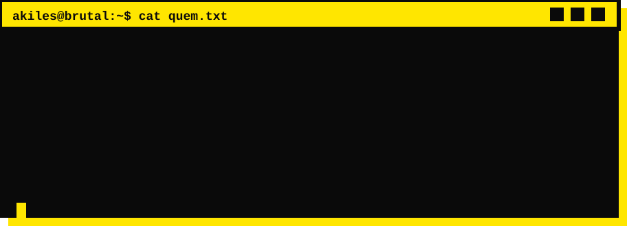
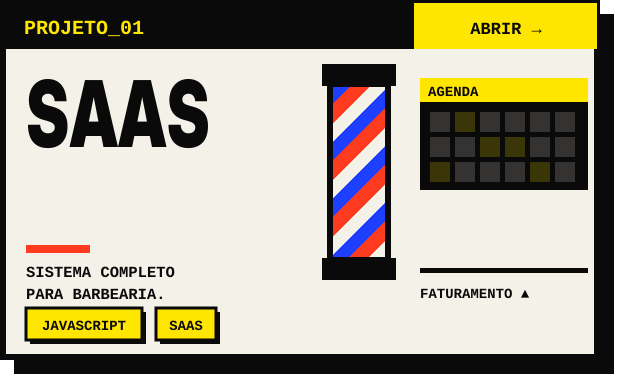
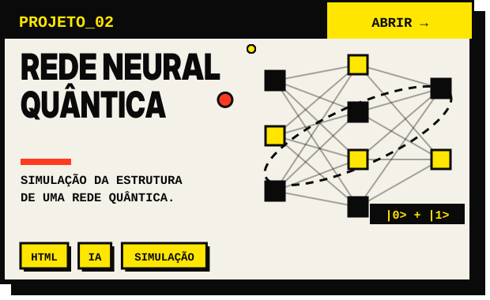
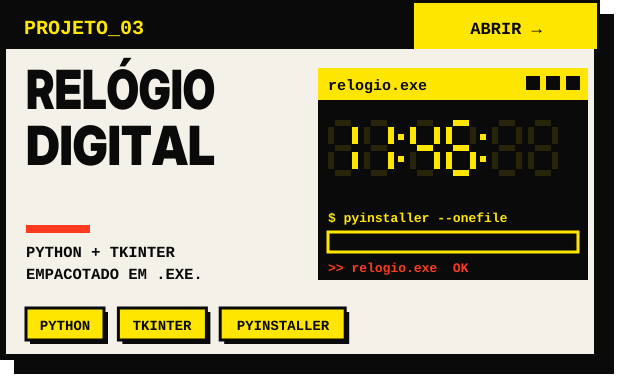
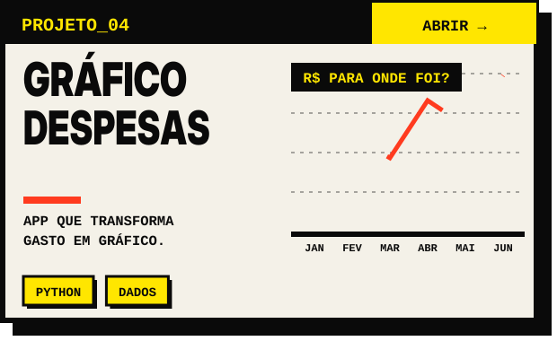
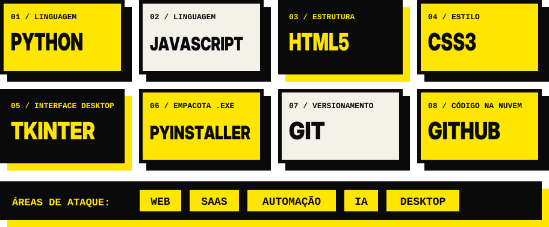
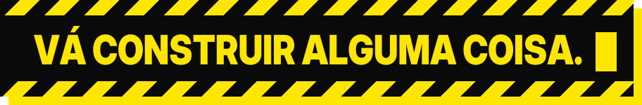

> **Não coleciono tutorial. Coleciono coisa que roda.**

<table>
<tr>
<td width="50%" align="center">

</td>
<td width="50%" align="center">

</td>
</tr>
<tr>
<td width="50%" align="center">

</td>
<td width="50%" align="center">

</td>
</tr>
</table>

Também no arsenal: [Projeto1](https://github.com/IanAkiles/Projeto1), uma lista de compras em Python.

<table>
<tr>
<td width="50%" align="center">

</td>
<td width="50%" align="center">

</td>
</tr>
</table>

