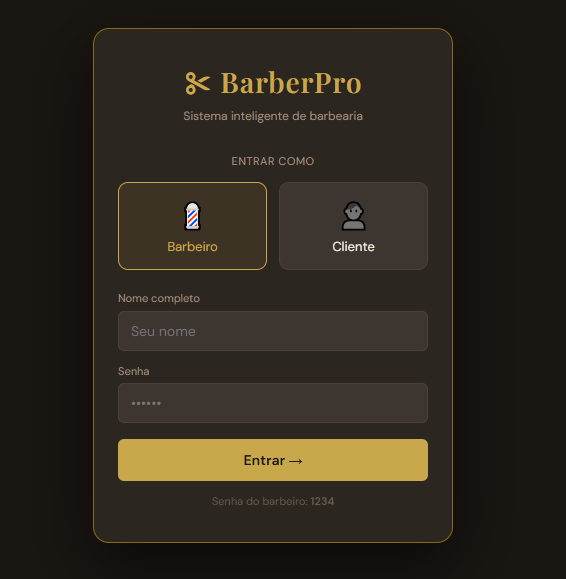
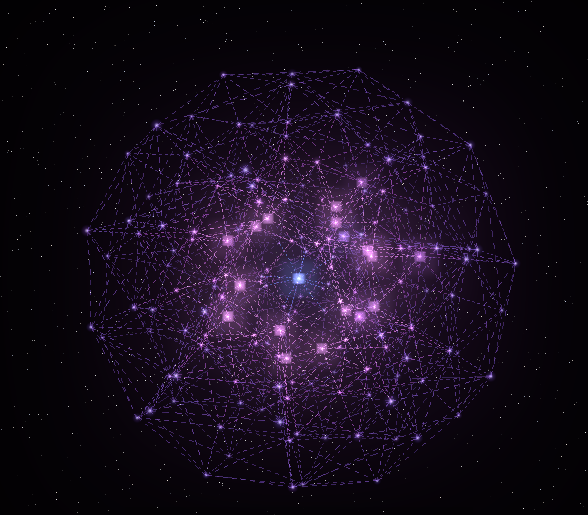

### Desenvolvimento web, sistemas, interfaces técnicas e projetos digitais experimentais

---

## Sobre

Sou Ian Akiles Gonçalves Vieira, desenvolvedor web. Construo sites, sistemas e interfaces técnicas, e gosto de explorar projetos digitais experimentais, como simulações e ferramentas que unem tecnologia e curiosidade.

Atuo com foco em:

- Desenvolvimento web (front-end e aplicações completas)
- Sistemas de gestão e aplicações SaaS
- Automação de tarefas com Python
- Interfaces técnicas e visualização de dados
- Projetos experimentais, incluindo computação quântica aplicada a redes neurais

---

## Stack

| Linguagens | Front-end | Ferramentas |
|:---:|:---:|:---:|
|  Python |  HTML5 |  Git |
|  JavaScript |  CSS3 |  GitHub |
| | |  VS Code |

---

## Projetos

### SaaS Barbearia

Sistema completo para barbearia, com tela de acesso para barbeiros e clientes.

[Repositório](https://github.com/IanAkiles/SaaS)

### Rede Neural Quântica

Simulação da estrutura de uma rede neural quântica, explorando a relação entre computação quântica e inteligência artificial.

[Repositório](https://github.com/IanAkiles/Rede-Neural-Quantica)

### Garimpo Tech

Página de achados e ofertas de tecnologia, com vitrine de produtos selecionados e acesso a um grupo no WhatsApp onde as ofertas são compartilhadas. Site estático construído com HTML, CSS e JavaScript puro, responsivo e com foco em acessibilidade.

[Repositório](https://github.com/IanAkiles/garimpo-tech)

### Gráfico de Despesas

Aplicativo para visualizar despesas em forma de gráfico.

[Repositório](https://github.com/IanAkiles/grafico_despesas)

### Relógio Digital em Python

Relógio digital com interface gráfica em Tkinter, empacotado em executável `.exe` com PyInstaller.

[Repositório](https://github.com/IanAkiles/relogio-digital-python)

### Lista de Compras

Aplicação em Python para organizar uma lista de compras.

[Repositório](https://github.com/IanAkiles/Projeto1)

---

## Estatísticas

 

## Contato

Para conversar sobre projetos, parcerias ou desenvolvimento web, acesse o portfólio:

[ianakiles.com.br](https://ianakiles.com.br/#contato)
